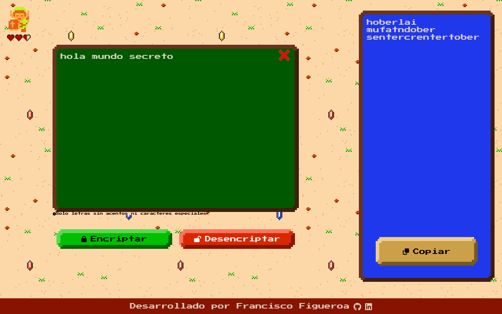
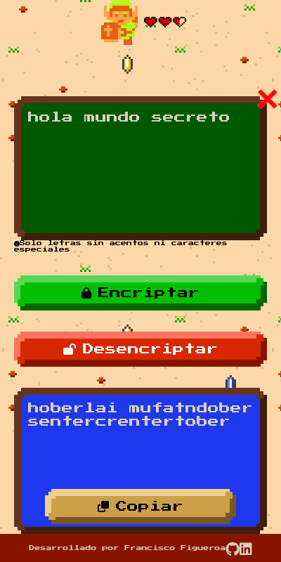

# :shield: Encriptador de texto

Encriptador y desencriptador de texto con estilo **8 bits inspirado en The Legend of Zelda de NES**, desarrollado para el Challenge ONE Principiante en Programación.

:point_right: [**Ver el proyecto en línea**](https://javierfig0.github.io/Encriptador-de-texto/)

<p align="center">
  
  &nbsp;
  
</p>

## :sparkles: Funcionalidades

- :lock: **Encriptar** y :unlock: **desencriptar** texto con las llaves del challenge.
- :clipboard: **Copiar** el resultado al portapapeles con un solo clic.
- :x: **Borrar** el texto y empezar de nuevo.
- :warning: **Validación**: avisa si el texto tiene acentos, `ñ`, números o caracteres especiales, y si el campo está vacío.
- :capital_abcd: **Mayúsculas**: se convierten automáticamente a minúsculas.
- :iphone: **Responsive**: se adapta a escritorio, tablet y celular.
- :wheelchair: **Accesible**: se puede usar con teclado y con lector de pantalla.

## :key: Llaves de encriptación

| Letra | Se convierte en |
| :---: | :---: |
| `e` | `enter` |
| `i` | `imes` |
| `a` | `ai` |
| `o` | `ober` |
| `u` | `ufat` |

Por ejemplo:

```
"gato"     =>  "gaitober"
"gaitober" =>  "gato"
```

El reemplazo se hace en **una sola pasada**, así el resultado de una llave nunca se confunde con otra y desencriptar siempre devuelve el texto original.

## :pushpin: Requisitos del challenge

- Debe funcionar solo con letras minúsculas (las mayúsculas se convierten automáticamente a minúsculas).
- No deben ser utilizados letras con acentos ni caracteres especiales (si se ingresan, se muestra un aviso de error).
- Debe ser posible convertir una palabra para la versión encriptada y también devolver una palabra encriptada para su versión original.
- La página debe tener campos para inserción del texto que será encriptado o desencriptado, y el usuario debe poder escoger entre las dos opciones.
- El resultado debe ser mostrado en la pantalla.

## :art: Diseño

Todo el diseño está hecho a mano con CSS, sin frameworks:

- **Paleta de colores de la NES**: verde bosque, azul, rojo y café, con el contraste necesario para que todo se lea bien.
- **Fondo de arena del overworld** con pasto, piedras y rupias, en una baldosa pixel art que se repite sin deformarse.
- **Marcos y botones pixelados** con esquinas recortadas, relieve de luz y sombra, y animación al apretarlos.
- **Fuente [Press Start 2P](https://fonts.google.com/specimen/Press+Start+2P)** en tamaños múltiplos de 8 para que las letras se vean nítidas.
- **Avisos estilo caja de diálogo** del juego.

## :rocket: Cómo usarlo

No necesita instalación ni dependencias: descarga o clona el repositorio y abre `index.html` en tu navegador.

```bash
git clone https://github.com/JavierFig0/Encriptador-de-texto.git
```

## :file_folder: Estructura

```
├── index.html   # estructura de la página
├── style.css    # diseño y responsive
├── reset.css    # reseteo de estilos del navegador
├── main.js      # lógica de encriptar, validar, copiar y avisos
└── img/         # imágenes y sprites
```

## :hammer_and_wrench: Construido con

* 
* 
* 

Íconos de [Font Awesome](https://fontawesome.com/) y fuente de [Google Fonts](https://fonts.google.com/).

> The Legend of Zelda es una marca de Nintendo. Este es un proyecto de práctica sin fines de lucro, hecho como homenaje.

## :e-mail: Contacto

<a href="https://www.linkedin.com/in/francisco-figueroa-wd/">  </a>
<a href="https://twitter.com/JavierF12618918">  </a>
